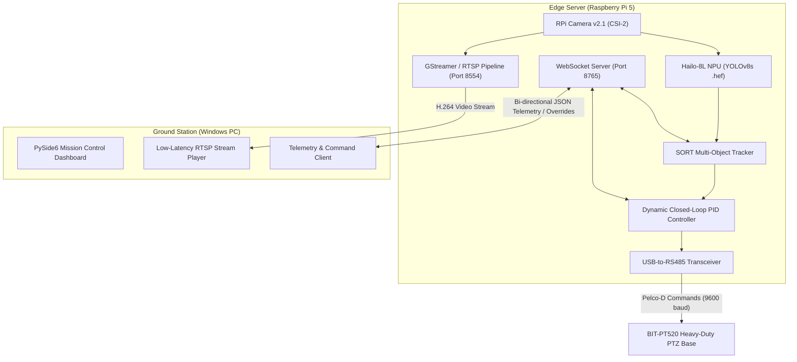

# Edge AI Optical PTZ Sky Tracking System 🎯🔭

[](https://opensource.org/licenses/MIT)
[](https://www.python.org/downloads/)
[](https://www.raspberrypi.com/)
[-brightgreen)](https://hailo.ai/)
[-red)](https://en.wikipedia.org/wiki/Pelco-D)
[](https://www.qt.io/)

A high-performance, real-time edge AI electro-optical object tracking platform engineered for high-altitude observation and UAV tracking. The system runs on a **Raspberry Pi 5** paired with a **Hailo-8L AI HAT+ (13 TOPS NPU via PCIe)** for low-latency deep learning inference. A tuned **PID-based closed-loop tracking algorithm** translates bounding box errors into dynamic Pan/Tilt speed commands over **RS-485 (Pelco-D protocol)** to drive an industrial **BIT-PT520 PTZ base**, eliminating hunting and camera jitter.

The system is monitored and commanded remotely via a dedicated **PySide6 Windows Mission Control** application over a single LAN connection.

---

## 🏗️ System Architecture



---

## 🚀 Key Features

* **Real-Time Edge AI Detection:** Hardware-accelerated inference utilizing the **Hailo-8L NPU (13 TOPS)** at high frame rates with negligible CPU utilization.
* **Closed-Loop PID PTZ Guidance:** Proportional-Integral-Derivative velocity controller maps target pixel offset to variable-speed Pelco-D commands (Pan/Tilt), preventing overshoot and tracking lag.
* **Low-Latency H.264 RTSP Streaming:** Zero-copy hardware pipeline integrated with GStreamer and `mediamtx` for instant video feedback.
* **Bi-directional JSON Telemetry & Overrides:** WebSocket server broadcasting real-time target bounding boxes, estimated distance/height, and receiving manual PTZ override commands.
* **Mission Control Center GUI:** Professional desktop application designed in Qt Designer / PySide6 with manual joystick controls, target acquisition lock, and telemetry graphs.

---

## 📁 Repository Structure

```text
edge-ai-ptz-tracker/
├── docs/                      # System schematics, wiring, and protocol references
├── pi-server/                 # Edge server backend running on Raspberry Pi 5
│   ├── models/                # Compiled Hailo-8 HEF neural network models
│   ├── src/
│   │   ├── main.py            # Primary edge server process & thread coordinator
│   │   ├── uav_detection.py   # HailoRT NPU inference engine
│   │   ├── sort.py            # Kalman-filter based multi-object tracker
│   │   ├── pantilt_setup.py   # Pelco-D RS-485 serial driver
│   │   ├── manual_manager.py  # Manual vs Auto control arbiter
│   │   ├── rtsp_stream.py     # GStreamer RTSP streaming pipeline
│   │   └── ws_server.py       # Asynchronous WebSocket telemetry server
│   ├── config.yaml            # Server configuration (IPs, ports, PID gains)
│   └── requirements.txt       # Edge server Python dependencies
└── windows-client/            # Mission Control desktop client
    ├── src/
    │   ├── main_client.py     # PySide6 application entry point
    │   ├── client_ui_helpers.py # UI widget stylers and asynchronous thread workers
    │   ├── ws_client.py       # WebSocket client handler
    │   ├── distance.py        # Target geometry & distance estimation
    │   ├── config.py          # Network endpoint configurations
    │   └── uxuinewset.ui      # Qt Designer XML interface specification
    └── requirements.txt       # Client desktop dependencies
```

---

## ⚙️ Quick Start Guide

### 1. Edge Server Setup (Raspberry Pi 5)
```bash
# Clone the repository
git clone https://github.com/titleww/edge-ai-ptz-tracker.git
cd edge-ai-ptz-tracker/pi-server

# Install dependencies (ensure HailoRT and GStreamer are configured)
pip install -r requirements.txt

# Start the edge tracking server
python src/main.py
```

### 2. Windows Mission Control Setup
```bash
cd windows-client

# Install GUI prerequisites
pip install -r requirements.txt

# Launch the desktop dashboard
python src/main_client.py
```

---

## 📜 License
This project is licensed under the [MIT License](LICENSE).
